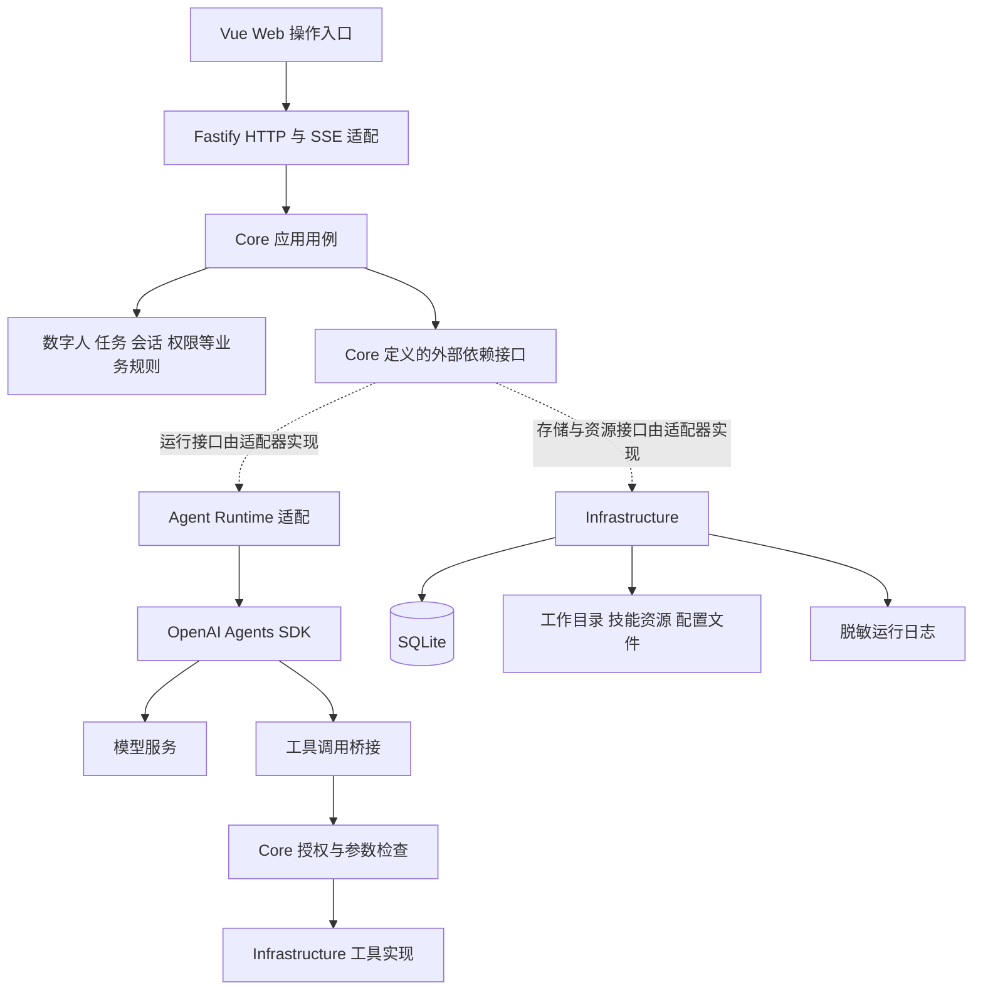
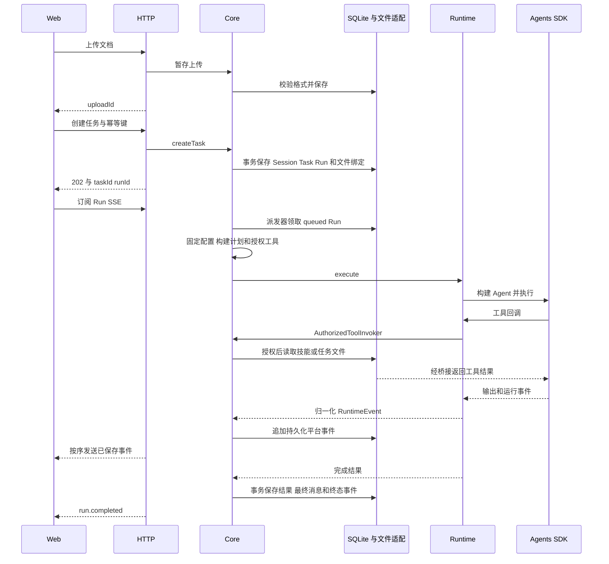

# 数字人智能体平台第一版架构基线

第一版交付一个通过网页操作的单数字人执行闭环，同时建立清晰的模块结构。架构需要覆盖完整系统的职责分工，代码只实现本次验收所需能力。扩展通过确定的依赖接口接入，后续能力在本文指定的位置增加。

本基线承接原始《数字人智能体平台 V1.0》设计，并以本次确定的网页验收范围为准。仓库已实现网页闭环和核心适配，完成情况与运行方式见根目录 README。真实供应商验收需要本地凭证，不以演示或本地接口测试替代。

本基线已补充自定义 MCP 只读工具闭环：配置、发现、数字人绑定、授权调用、超时/取消、网页执行记录与 MCP 管理，详细配置见 docs/extensions.md。

## 一 交付目标与范围

### 首个验收场景

用户打开网页，选择配置好的“需求分析师”，上传 UTF-8 编码的 Markdown 或纯文本需求文档，输入分析要求并提交。数字人按需加载需求分析技能，通过受控文件工具读取文档，执行多步分析；网页显示状态、文本和工具调用。结果与记录持久化，刷新页面或重启服务后可查询已保存的内容。

页面首先以卡片展示所有数字人，停用或缺少配置的数字人仍可查看详情与历史。点击卡片打开双栏抽屉，左侧是该数字人的会话，右侧是所选会话的消息与输入框，数字人详情通过上层独立弹框展示；网页增删改数字人暂不开放。

一次发送对应一个 Task 和一个 Run。首次发送创建 Session，追问复用该 Session；会话只能归属一个数字人。同一会话回复期间不能再次提交，其他会话可以排队。服务端同一时间执行一个 Run。

### 范围划分

| 能力 | 第一版交付 | 后续扩展 |
| --- | --- | --- |
| Web | 数字人卡片、双栏会话抽屉、文字与文档消息、连续追问、执行展示、历史、取消、MCP 管理 | 数字人、模型与技能配置后台 |
| 数字人 | 从配置导入、校验、列表、详情、启停配置 | 网页增删改、岗位模板 |
| 模型 | 配置注册、按数字人绑定；完成一个真实模型的闭环 | 新增模型协议与供应商适配 |
| 工具 | 注册、Schema 校验、授权、受控执行、MCP 只读工具 | 写文件、通用 HTTP、其他 Agent |
| 技能 | 发现元数据、绑定、按需读取正文和引用文件 | 安装、更新、版本管理 |
| Runtime | Agent 构建、SDK 执行、流式事件、超时、取消、轮次限制 | 审批恢复、协作、结构化输出策略 |
| Session | 多轮业务消息持久化、按数字人隔离、有限历史回放 | SDK 专有运行状态保存与恢复 |
| 任务记录 | 任务、运行、工具调用、事件、结果持久化 | 自动重试、队列与分布式执行 |
| 权限 | 工具白名单、任务目录和技能资源只读、凭证保护 | 人工审批、隔离沙箱 |
| 其他 | 明确未来接入位置 | 知识库、长期记忆、压缩、调度、消息渠道、工作流 |

第一版不以多个供应商同时兼容作为交付前提。模型协议适配边界必须落地，实际支持范围按供应商兼容性验证记录声明。

上传首版只接受 `.md`、`.txt`，单文件上限 2 MiB，每次消息可选一个文件。追问未上传时复用本会话最近的文件；无文件时支持纯文字交流。PDF、Word 和图片解析后续通过文档提取适配器加入。

## 二 技术与部署形态

| 部分 | 技术决策 |
| --- | --- |
| 工程 | TypeScript、pnpm Workspace、模块化单体 |
| Web | Vue 3、Ant Design Vue 4.2.6、Vite、Vue Router；使用原生 EventSource 消费 SSE |
| API | Node.js LTS、Fastify、Zod |
| Agent | OpenAI Agents SDK；平台不实现模型与工具循环 |
| 数据 | SQLite、Drizzle ORM；单服务进程、单运行消费者 |
| 文件 | 本地磁盘；通过平台文件标识访问 |
| 日志 | Pino；业务事件另存 SQLite |
| 验证 | Vitest 验证边界与集成，Playwright 验证网页闭环 |

开发环境由 Vite 将 `/api` 代理至 Fastify。交付环境由 Fastify 同源提供 Web 静态产物、API 和 SSE，避免新增网关与跨域配置。默认仅监听 `127.0.0.1`，服务端拒绝不受信任的 Origin；绑定公网、团队账号与多租户部署属于后续交付，需要增加认证与资源归属校验。

具体依赖版本在初始化工程时选取并写入锁文件，不以“最新版”作为依赖声明。

## 三 总体架构



图中实线表示请求或执行方向，虚线表示接口实现关系。源码依赖以第五节为准：Core 定义接口，适配器依赖 Core；Core 不导入具体适配器。

### 完整系统的职责分层

| 层 | 责任 | 第一版归属 | 后续能力的归属 |
| --- | --- | --- | --- |
| 交互层 | 用户输入、展示、渠道协议转换 | `apps/web`、`apps/server/http` | CLI、新渠道应用 |
| 应用层 | 创建任务、查询记录、取消运行、组织一次执行 | `core/application` | 数字人管理用例、审批用例 |
| 数字人层 | 身份、能力绑定、启停、配置引用 | `core/domain` 的 Worker 配置 | 更多岗位与生命周期规则 |
| 编排层 | 决定任务何时执行、如何衔接 | `core/application/platform.ts` 内的串行派发 | 工作流、调度和协作，新增独立编排模块 |
| 运行层 | 构建 Agent、模型适配、SDK 调用、事件转换 | `agent-runtime` | MCP OAuth、审批恢复 |
| 能力层 | 模型、技能、工具等能力的注册与解析 | Core 注册规则加对应适配器 | Knowledge 与更多工具来源 |
| 运行支撑层 | 上下文、权限、会话、文件与资源约束 | Core 策略加 Infrastructure 实现 | Memory、压缩、沙箱 |
| 基础设施层 | 数据库、磁盘、配置、日志和密钥解析 | `infrastructure` | 对象存储、向量库、队列 |

“完整”指所有职责都有归属，首版不预建尚无调用者的 Workflow、Memory、Knowledge 等空模块。

## 四 目录结构与代码归属

以下为当前实现结构。较小模块按职责集中在单个文件，出现实际复杂度后再按实体拆分；`data`、`workspaces` 是运行时目录，不提交内容。

```text
personal-agent/
├── apps/  # 客户端与服务入口
│   ├── server/
│   │   ├── src/
│   │   │   ├── bootstrap/
│   │   │   │   └── index.ts
│   │   │   ├── http/
│   │   │   │   └── sse/
│   │   │   │       └── index.ts
│   │   │   ├── app.ts
│   │   │   └── main.ts
│   │   ├── README.md
│   │   └── package.json
│   └── web/
│       ├── src/
│       │   ├── features/
│       │   │   ├── tasks/
│       │   │   │   └── useRun.ts
│       │   │   └── workers/
│       │   │       ├── ConversationTurn.vue
│       │   │       ├── SessionSidebar.vue
│       │   │       ├── WorkerDetails.vue
│       │   │       └── WorkerDialog.vue
│       │   ├── lib/
│       │   │   ├── api.ts
│       │   │   └── markdown.ts
│       │   ├── pages/
│       │   │   ├── History.vue
│       │   │   ├── Mcp.vue
│       │   │   └── Workers.vue
│       │   ├── ui/
│       │   │   └── theme.ts
│       │   ├── App.vue
│       │   ├── main.ts
│       │   └── style.css
│       ├── README.md
│       ├── index.html
│       ├── package.json
│       ├── tsconfig.json
│       └── vite.config.ts
├── config/  # 平台、模型、权限与 MCP 配置
│   ├── README.md
│   ├── mcp.yaml
│   ├── models.yaml
│   ├── permissions.yaml
│   └── platform.yaml
├── data/  # 运行时数据，不提交
├── docs/  # 架构与扩展说明
│   ├── examples/
│   │   └── team-task-board-requirements.md
│   ├── architecture-v1.md
│   ├── extensions.md
│   └── mcp-verification.md
├── mcp-servers/  # 独立 MCP 示例服务，不依赖平台业务模块
│   └── reference/
│       ├── resources/notes/
│       │   ├── acceptance-guide.md
│       │   └── platform-overview.md
│       ├── src/index.mjs
│       └── package.json
├── packages/  # 共享契约与内部模块
│   ├── agent-runtime/
│   │   ├── src/
│   │   │   ├── factory/
│   │   │   │   └── index.ts
│   │   │   ├── mcp/
│   │   │   │   └── index.ts
│   │   │   ├── models/
│   │   │   │   └── index.ts
│   │   │   ├── runner/
│   │   │   │   ├── demo.ts
│   │   │   │   └── index.ts
│   │   │   └── index.ts
│   │   ├── README.md
│   │   └── package.json
│   ├── contracts/
│   │   ├── src/
│   │   │   ├── errors.ts
│   │   │   ├── events.ts
│   │   │   ├── index.ts
│   │   │   ├── mcp.ts
│   │   │   ├── runs.ts
│   │   │   ├── sessions.ts
│   │   │   ├── tasks.ts
│   │   │   ├── uploads.ts
│   │   │   └── workers.ts
│   │   ├── README.md
│   │   └── package.json
│   ├── core/
│   │   ├── src/
│   │   │   ├── application/
│   │   │   │   ├── context/
│   │   │   │   │   └── builder.ts
│   │   │   │   ├── mcp/
│   │   │   │   │   └── management.ts
│   │   │   │   ├── tools/
│   │   │   │   │   └── invoker.ts
│   │   │   │   └── platform.ts
│   │   │   ├── domain/
│   │   │   │   └── index.ts
│   │   │   ├── ports/
│   │   │   │   └── index.ts
│   │   │   └── index.ts
│   │   ├── README.md
│   │   └── package.json
│   └── infrastructure/
│       ├── migrations/
│       │   ├── 0001_initial.sql
│       │   └── 0002_conversations.sql
│       ├── src/
│       │   ├── config/
│       │   │   ├── load.ts
│       │   │   └── mcp-settings.ts
│       │   ├── credentials/
│       │   │   └── environment.ts
│       │   ├── database/
│       │   │   ├── schema/
│       │   │   │   └── index.ts
│       │   │   └── store.ts
│       │   ├── files/
│       │   │   └── store.ts
│       │   ├── logging/
│       │   │   └── index.ts
│       │   ├── tools/
│       │   │   └── builtin.ts
│       │   └── index.ts
│       ├── README.md
│       └── package.json
├── resources/  # 数字人与技能资源
│   ├── skills/
│   │   └── requirement-analysis/
│   │       ├── references/
│   │       │   └── acceptance.md
│   │       └── SKILL.md
│   ├── workers/
│   │   └── analyst.yaml
│   └── README.md
├── scripts/  # 工程约束检查
│   └── check-boundaries.mjs
├── tests/  # 集成与浏览器验收
│   ├── e2e/
│   │   └── workbench.spec.ts
│   ├── fixtures/
│   │   ├── mcp-server.mjs
│   │   ├── runtime.ts
│   │   └── sample.md
│   ├── integration/
│   │   ├── mcp-management.test.ts
│   │   ├── mcp-sdk.test.ts
│   │   ├── mcp.test.ts
│   │   ├── platform.test.ts
│   │   ├── sdk-compatible.test.ts
│   │   └── sessions.test.ts
│   └── README.md
├── workspaces/  # 运行时工作目录，不提交
├── .env.example
├── .gitignore
├── .prettierignore
├── .prettierrc.json
├── AGENTS.md
├── README.md
├── package.json
├── playwright.config.ts
├── pnpm-lock.yaml
├── pnpm-workspace.yaml
├── tsconfig.base.json
├── tsconfig.json
└── vitest.config.ts
```

单元测试放在相应源码旁，跨模块测试放在根目录 `tests/`。首版不设泛化 `shared/utils` 包；有明确跨端契约的类型进入 contracts，业务类型进入 Core，具体实现留在所属模块。

## 五 包依赖与模块边界

箭头表示左侧可以导入右侧。

```text
apps/web ────────────────────→ contracts
apps/server ────────────────→ contracts + core + agent-runtime + infrastructure
core ──────────────────────→ contracts
agent-runtime ──────────────→ core + contracts + OpenAI Agents SDK
infrastructure ────────────→ core + contracts + SQLite/Drizzle/磁盘等实现
contracts ─────────────────→ Zod
```

Core 使用 contracts 中稳定的状态、事件和通用数据 Schema；HTTP 路径、状态码、Fastify request/reply 不进入 Core。前端只能导入 contracts，不能间接打包服务端代码。只有 `agent-runtime` 可以导入 Agents SDK；SDK 的类型与原始事件不能出现在其他包的公共接口中。

| 模块 | 负责 | 不能承担 |
| --- | --- | --- |
| contracts | 请求、响应、事件、错误的 Schema 与类型 | 业务流程、文件读取、密钥、SDK 对象 |
| core | 数字人规则、注册解析、任务生命周期、授权、上下文、外部依赖接口 | 监听 HTTP、SQL、磁盘实现、SDK Loop |
| agent-runtime | 模型协议适配、AgentFactory、SDK Runner、工具桥接、事件归一化 | 创建任务、直接修改业务数据库、自行绕过授权执行工具 |
| infrastructure | Core 接口的具体实现 | 决定任务状态如何变化、决定工具是否被授权 |
| server | 装配具体实例、路由映射、SSE 传输、进程管理 | 在路由内编写 Agent 执行循环和 SQL |
| web | 输入校验、用户操作、事件展示和恢复 | 保存密钥、控制真实权限、依赖 SDK 事件 |

各包只从公开入口导入；禁止跨包引用 `src` 内部路径。初始化工程时配置包导出和静态导入约束，防止以上边界只停留在文档中。

### 核心接口的所有权

| 接口或模块 | 定义位置 | 实现或使用位置 |
| --- | --- | --- |
| `AgentRuntime.execute(plan, tools, emit, signal)` | Core ports | agent-runtime 实现，Core 调用；tools 的回调指向 Core 授权入口 |
| `PlatformStore` | Core ports | infrastructure/database 实现；聚合资源导入、任务、运行、消息、工具记录和事件存储 |
| 创建任务与终态事务 | PlatformStore 的 createTask 与 finish | Infrastructure 内部完成原子写入，Core 不持有 SQL 事务对象 |
| `FileStore` | Core ports | infrastructure/files 实现上传存储、读取与工作目录 |
| 技能发现与快照 | Infrastructure config/load | 启动时加载；后续多来源接入再提取 SkillSource |
| `CredentialResolver` | Core ports | infrastructure/credentials 实现，仅 Runtime 模型适配器调用 |
| `Logger` | Core ports | infrastructure/logging 实现 |
| 模型技能工具注册表 | Core domain 的 Registry | 以不同类型实例注册，启动校验重复 ID 与绑定引用 |
| `authorizedTools` 授权执行入口 | Core application/tools | Runtime 的每个工具执行回调都调用它 |
| `ContextBuilder` | Core application | 输出可序列化执行计划，不创建 SDK 对象 |

`ExecutionPlan` 包含 worker/task/run 标识、模型描述与凭证引用、拼接后的指令、技能索引、输入、执行限制和配置快照。已授权 RuntimeTool 通过独立参数传入，凭证解析器通过构造函数注入；回调和凭证解析结果不能序列化进执行快照。

### 能力配置的最小字段

| 配置 | 首版必须定义的字段 |
| --- | --- |
| Worker | id、name、description、role、instructions、modelId、skillIds、toolIds、permissionPolicyId、status |
| Model | id、provider、protocol、baseURL、model、apiKeyRef、maxOutputTokens、enabled |
| Skill | id、name、description、资源根标识、version |
| Tool | id、name、description、输入 Schema、riskLevel、requiresApproval、enabled、执行回调 |
| PermissionPolicy | id、allowedToolIds、任务文件读取规则、技能资源读取规则 |

Worker 的人格与头像是可选字段，workspace 由服务端根据 workerId/taskId 派生，不能由网页指定。尚未实现 Memory 和 Knowledge 时不要求虚构相应资源 ID。MCP 使用 mcpServerIds 绑定服务，并通过 toolIds 绑定白名单工具。Model 的 protocol 首版接受 `responses` 或 `chat_completions`，provider 用于选择适配器；不支持的组合在启动时拒绝。Tool 是进程内注册对象，执行回调不出现在对外 DTO 或持久化配置中。

## 六 实体与数据归属

| 实体 | 含义 | 第一版约束 |
| --- | --- | --- |
| DigitalWorker | 可复用的业务身份与能力配置 | 通过配置导入，配置变更不影响已开始运行 |
| Session | 归属于一个数字人的交互容器 | 首条消息创建，后续 Task 可复用；跨数字人复用被拒绝 |
| Task | 用户的一次消息或工作请求 | 固定 workerId、sessionId、input 与可空 uploadId |
| Run | Task 的一次实际执行尝试 | 每 Task 一个；后续可按 attempt 扩展多个 |
| Upload | 上传文件及归属元数据 | 首次绑定记录 Task；同一会话后续消息可引用，其他会话不能复用 |
| ToolCall | Run 内的一次工具调用 | 记录授权结果、执行状态和脱敏结果摘要 |
| RunEvent | Run 内可展示且有序的事件 | 持久化后才对网页可见 |
| Message | Session 中的业务消息 | 保存用户输入与最终回复；不等于 SDK 完整历史 |

数字人 1:N Session，Session 1:N Task，Task 1:N Run 是关系模型；当前每 Task 一个 Run。Task 的展示状态取唯一 Run 的状态，不在两张表维护两套状态机。会话标题、最近更新时间和轮数从其 Task 派生，未发送的空会话只保存在浏览器草稿状态。

### 首版数据库

| 表 | 数据和关键约束 |
| --- | --- |
| `digital_workers` | worker 配置、能力 ID 数组、状态、配置版本；id 唯一 |
| `model_configs` | provider、protocol、baseURL、模型名、凭证引用；不保存明文密钥 |
| `skill_catalog` | 技能元数据、资源根标识、内容版本；不暴露本地绝对路径 |
| `permission_policies` | 工具白名单与资源规则；配置导入 |
| `uploads` | 服务端生成的 ID、原文件名、格式、大小、内容 hash、存储 key、taskId |
| `sessions` | workerId、创建时间 |
| `messages` | sessionId、taskId、role、content |
| `tasks` | workerId、sessionId、input、uploadId、提交幂等键、请求摘要 |
| `agent_runs` | taskId、attempt、status、快照、输出、usage、错误、开始结束时间 |
| `tool_calls` | runId、callId、toolId、授权状态、脱敏参数、摘要、耗时 |
| `run_events` | runId、seq、type、schemaVersion、payload、createdAt |

必要约束：外键启用；`agent_runs(taskId, attempt)` 唯一；`run_events(runId, seq)` 唯一；提交幂等键唯一；Upload 首次绑定后不重新分配所属会话。任务列表按创建时间与插入顺序稳定排序并分页。新增迁移按四位编号顺序执行，已应用迁移的 hash 不得改变；迁移事务完成前执行外键完整性校验。

首版能力绑定使用 worker 配置中的 ID 数组，启动校验引用完整性，避免同时维护数组和关联表两套真相。配置文件是数字人、模型、技能与权限的管理来源，数据库保存当前导入版本和历史运行快照；任务、文件绑定、消息和运行数据以数据库为准。工具执行函数只存在于代码注册表，不存入数据库。

运行快照保存所选数字人、模型非敏感配置、权限和绑定技能的正文及资源快照；正文仍需经工具调用才进入模型上下文。技能内容 hash 作为技能版本，Run 中保存的完整配置是运行版本依据。配置或资源更新在下次启动导入，活动 Run 使用已固定版本。MCP 工具保存配置和 Schema 的 hash 与非敏感修订号；网页变更立即作用于新任务，活动和排队任务保留原工具与凭证闭包，重启后拒绝不匹配的旧任务调用。密钥解析结果、回调函数和 SDK 实例不进入快照。

## 七 启动装配与运行生命周期

### 启动顺序

1. 解析服务端环境变量与平台配置，检查路径、限制和凭证引用格式。
2. 打开 SQLite 并执行迁移，初始化上传暂存和任务工作目录。
3. 扫描数字人、模型、权限与技能配置，注册内置工具，校验所有引用；重复 ID 或无效引用使启动失败。
4. 将有效资源版本导入数据库，为只读查询准备安全 DTO。
5. 构造 Infrastructure 实例、Runtime 和 Core 用例，由 server 注入依赖。
6. 将上次进程遗留的 `running` Run 标记为 `failed / PROCESS_INTERRUPTED`，保存终态事件；遗留 `queued` Run 保持排队。
7. 启动串行 Run 派发器和 HTTP 服务，对外报告就绪。

缺少模型凭证时允许启动网页，但数字人 DTO 标记 ready=false 并显示配置提示，创建任务返回 MODEL_NOT_CONFIGURED。配置格式或引用错误仍使启动失败。实际连通性和工具兼容性由模型验证用例检查。

### 网页执行流程



Runtime 的事件回调使用异步确认；Core 完成事件写入后才返回。Core 在调用 Runtime 前写入 `run.started`；工具开始、完成和拒绝由授权执行入口产生。SDK 工具事件只用于关联与去重，不能另产生一份同义 ToolCall。文本与用量由 Runtime 转换，终态由 Core 统一生成。

派发器是应用层的进程内执行组件，每次以条件更新领取一个 queued Run。数据库是待执行任务的依据，内存只持有活动 Run 的 AbortController 和唤醒信号。创建任务提交成功后即使进程退出，启动派发器也能发现尚未开始的 queued Run。

### 状态机

```text
queued  → running → succeeded
   │          ├──→ failed
   │          └──→ cancelled
   └─────────────→ cancelled
```

终态不可回到运行态。超时归为 `failed / RUN_TIMEOUT`，轮次上限归为 `failed / MAX_TURNS_EXCEEDED`，服务中断归为 `failed / PROCESS_INTERRUPTED`。活动运行取消时先中止并等待 Runtime 释放，再完成终态；排队取消直接持久化。完成和取消竞争时采用状态条件更新，首次成功写入的终态有效。

首版不自动重试失败 Run，不恢复已经执行中的模型或工具步骤；用户重新提交会创建新 Task。关闭服务时停止接单与派发，中止活动 Run，尽量保存中断记录再关闭数据库。异常退出后按启动恢复规则收敛状态。

取消通过信号传入 SDK 和工具；它不能撤销已经完成的外部副作用。首版只启用只读工具。

## 八 HTTP 接口与网页边界

| 接口 | 语义 |
| --- | --- |
| `GET /api/health` | 就绪与非敏感版本信息 |
| `GET /api/workers` | 所有数字人的安全摘要，包括状态与是否可发送消息 |
| `GET /api/workers/:workerId` | 安全详情：身份、能力名称，不含密钥或服务器路径 |
| `GET /api/mcp` | MCP 配置、绑定、验证状态与工具摘要，凭证只返回是否已保存 |
| `POST /api/mcp/probe` | 测试草稿连接并发现工具，不保存配置 |
| `POST /api/mcp` | 新增 MCP 服务、工具白名单与数字人绑定，携带 expectedRevision |
| `PUT /api/mcp/:id` | 编辑、启停或更新绑定；并发版本冲突返回 409 |
| `DELETE /api/mcp/:id` | 按 expectedRevision 删除服务并解除新任务绑定 |
| `POST /api/uploads` | multipart 单文件上传，返回 uploadId 和安全元数据 |
| `POST /api/tasks` | `{ workerId, input, uploadId?, sessionId? }`，请求头带 `Idempotency-Key` |
| `GET /api/sessions` | 按必填 workerId 查询会话摘要，支持 limit 与 offset |
| `GET /api/sessions/:sessionId` | 查询会话归属、标题、轮数与最新状态 |
| `GET /api/tasks` | 分页历史列表，允许按 workerId 与 sessionId 同时过滤 |
| `GET /api/tasks/:taskId` | 输入、文件元数据、Run 摘要、最终结果 |
| `GET /api/runs/:runId` | 状态、用量、工具记录和错误 |
| `GET /api/runs/:runId/events` | SSE，支持 `after` 游标与 `Last-Event-ID` |
| `POST /api/runs/:runId/cancel` | 幂等取消；对终态返回当前状态 |

创建任务必须验证数字人启用、模型与能力可用。指定 sessionId 时，事务内验证其 workerId 归属和无活动运行；指定 uploadId 时验证未绑定或属于同一会话，未指定时查找本会话最近文件。事务写入首条消息所需的 Session、用户 Message、Task、queued Run 和首条事件。上传内容保存在 `data/uploads/{storageKey}`，数据库映射决定授权，不依赖跨目录移动成功；模型看不到磁盘路径。

相同幂等键和相同请求返回原 taskId/runId；请求内容变化返回 `409 IDEMPOTENCY_CONFLICT`。网页提交时生成幂等键，网络重试沿用该键，用户主动创建下一次任务时生成新键。

统一错误结构为 `{ code, message, requestId, details? }`。配置与输入问题映射为 400，资源不存在为 404，状态或绑定冲突为 409，上传超限为 413，执行期错误保存在 Run；数据库或 HTTP 内部异常返回脱敏 500。contracts 维护精确 Schema。

网页包含数字人卡片页、全局执行记录页和 MCP 管理页。会话抽屉由数字人卡片打开，左侧列表始终按 workerId 查询，右侧按 sessionId 分页展示 Task 对应的用户消息与助手回复。网址保存 worker 与 session 选择，旧任务详情链接转换为对应会话。最新运行从游标 0 补读事件，终态使用最终结果并关闭 EventSource；较早回复从持久化记录加载。

网页展示执行状态、可见文本、工具名称与结果摘要，不展示模型内部推理链。会话接口不接受任意系统指令、文件绝对路径、工具 ID 列表或密钥来覆盖服务端配置。MCP 管理使用独立配置接口，凭证只写不回显。

## 九 事件协议与持久化

每条持久化事件具有 `schemaVersion: 1`、`runId`、Run 内单调递增的 `seq`、`type`、`createdAt` 和类型对应的 `payload`。contracts 使用判别联合校验不同 payload，禁止向前端直接转发原始 SDK 对象。

| 事件 | 生产者 | 内容 |
| --- | --- | --- |
| `run.queued` | 创建任务用例 | 排队状态 |
| `run.started` | Core 执行用例 | 开始时间与安全配置摘要 |
| `output.delta` | Runtime 适配后交给 Core | 文本增量 |
| `tool.started` | Core 工具执行入口 | callId、toolId、安全参数摘要 |
| `tool.completed` | Core 工具执行入口 | callId、耗时、结果摘要 |
| `tool.failed` | Core 工具执行入口 | callId、安全错误码 |
| `tool.denied` | Core 工具执行入口 | callId、拒绝原因 |
| `usage.updated` | Runtime 适配后交给 Core | 累计输入、输出 token，未提供值为 null |
| `run.completed` | Core 执行用例 | 最终结果引用与终态用量 |
| `run.failed` | Core 执行用例 | 安全错误码和用户可读信息 |
| `run.cancelled` | Core 取消或执行用例 | 取消时间 |

SDK 文本增量在新增量到达时按 100 毫秒窗口或 4 KiB 阈值合并后写入，不逐 token 写数据库；工具调用前和正常结束前刷新文本缓存，异常时仅保留已经写入的片段。用量按供应商实际返回值累计，不估算缺失值，不将每次累计值重复相加。供应商未提供用量的字段保存为 null。

SSE 使用 `id: seq`、`event: type`、`data: JSON`。服务端每 250 毫秒按游标分批查询已提交事件，每 15 秒发送不持久化的心跳注释。由数据库补读同时覆盖历史与新事件，首版无需额外 EventBus、Redis 或订阅竞态处理。慢客户端限制每批数据量并在断连后释放轮询资源。

首次订阅使用 `after`，自动重连优先使用 `Last-Event-ID`。客户端按 runId 和 seq 去重；无效或超过当前末尾的游标返回 400。终态事件发送完毕后关闭连接。事件和运行结果保留至用户显式清理，首版不提供自动清理入口。

关闭网页或 SSE 断连不取消任务。进程内事件尚未持久化即崩溃时，允许末尾文本片段缺失；该 Run 必须呈现中断失败，不得显示成功。最终输出、最终 Message、Run 终态和终态事件在同一事务提交。

## 十 工具技能与权限

### 工具执行唯一入口

```text
模型请求工具
  → Runtime 工具桥接
  → Core 校验 Run 活动状态和输入 Schema
  → 校验数字人绑定与权限策略
  → 校验任务或技能资源归属
  → 调用 Infrastructure 实现
  → 保存脱敏调用记录与事件
  → 结果经 Runtime 返回模型
```

工具可调用的条件为：已注册且启用、数字人已绑定、策略允许、当前 Run 的资源规则允许。任一条件不满足即拒绝，deny 优先。构建 Agent 时过滤工具，执行回调前再校验；仅隐藏工具描述不足以作为授权措施。

第一版所有需审批或标记为 high 风险的工具直接返回 `APPROVAL_NOT_SUPPORTED`，不提供自动批准、不生成虚假的审批记录。新增高风险工具前再实现审批状态和沙箱。

### 首版工具

| 工具 | 输入 | 权限与行为 |
| --- | --- | --- |
| `load_skill` | skillId | 仅返回当前数字人已绑定技能的正文 |
| `read_skill_resource` | skillId、技能内相对路径 | 仅允许该技能根内的 references/assets 文本；限制格式和大小 |
| `read_file` | fileId、offset、limit | 仅允许当前 Task 引用且属于同一数字人与会话的文件；分段 limit 不超过 32,000 |
| `mcp_<服务ID>__<工具名>` | 发现得到并经过校验的对象 Schema | 服务白名单 + worker.mcpServerIds/toolIds + policy.allowedToolIds；首版只读文本结果，不超过 128,000 UTF-8 字节 |

首版 fileId 等于 uploadId；对模型只作为文件标识使用。read_file 的 offset 默认 0、limit 默认 32,000，返回 content、offset、nextOffset、totalChars 和 truncated。所有资源读取工具使用相同的有界分段原则；参数均由各工具 Schema 校验。

工具不接受操作系统绝对路径。技能资源相对路径必须规范化并进行 realpath 范围校验，拒绝穿越和符号链接逃逸。文件读取校验当前 Run、Task 与文件首次绑定 Task 的数字人和会话归属，不能猜测 uploadId 跨会话读取。无附件时不向 Agent 注册 read_file。配置、密钥、数据库和其他会话资源均不可读。

### 技能渐进加载

启动扫描仅建立技能 ID、名称、description 与版本索引。ContextBuilder 注入当前数字人已绑定的索引，不一次性注入全部正文。模型通过 `load_skill` 获取正文，再按需用 `read_skill_resource` 获取引用内容；资源路径不隐式授予普通文件访问权限。

需求分析师的职责指令明确要求该场景先加载需求分析技能、再通过 `read_file` 读取上传文档。真实闭环验收需观察到这两次工具调用，不能通过预先将全文注入提示词跳过工具机制。技能脚本首版不执行。

### 指令和凭证边界

平台规则与数字人职责放入受信任指令，用户输入按用户消息处理，上传文件与引用资料作为不可信工具内容返回。技能内容也不能扩大工具权限；防越权最终由程序校验保障。

API Key 仅由服务端凭证适配器读取后交给模型客户端。日志和审计记录只保存白名单字段、脱敏摘要和错误码，不记录 HTTP Authorization、完整 SDK 请求或环境变量。上传原文与完整分析结果属于业务数据，按任务存储，不复制到运维日志。首版关闭 SDK 对外追踪导出，保留本地事件与调用记录。

## 十一 上下文与会话边界

ContextBuilder 的组织顺序固定为平台规则、数字人身份与职责、工具及资源约束、已绑定技能索引、用户输入与当前 Task 文件元数据。文件内容在工具调用后进入 SDK 上下文。执行限制和权限对象作为不可由模型修改的运行上下文传给工具回调。

Session 保存多轮用户输入与最终回复。Core 从同一会话已完成的 Task 中读取最近最多 20 条完整用户与助手消息，按整轮保留且总量不超过 32,000 字符；Runtime 转换为 SDK 输入并添加当前消息。失败、取消或仍在执行的消息不作为完成的历史轮次回放。该机制支持文字追问，不恢复上次 Run 的工具调度或 SDK 专有运行状态；这些状态恢复仍属后续扩展。

首版验收使用有限的任务输入、单文件与单技能；框架支持绑定多个技能。默认输入最多 10,000 字符、内置文本工具单次返回最多 32,000 字符、10 轮、180 秒，模型输出上限由模型配置设置。部署配置可在受校验范围内调整。超长文件返回显式截断标识与已读范围，允许 `read_file` 通过受限 offset/limit 分段读取，不能静默视为全文。上下文超过模型限制时模型适配器报告调用失败，摘要压缩后续加入。

### MCP 连接与执行

Infrastructure 从 config/mcp.yaml 读取首次启动的服务种子，后续通过 LocalMcpSettingsStore 原子保存到数据目录的 mcp-settings.json，文件权限为 0600；Core 的 McpManagement 管理连接、白名单、数字人绑定、并发修订与配置快照；Runtime 的 McpToolRegistry 使用 SDK 连接 Stdio / Streamable HTTP。bootstrap 发现所有已启用服务，并将绑定数字人的白名单工具与内置工具一起装配到注册表及权限策略。未直接将原生 mcpServers 暴露给 Agent，所有回调仍经过 authorizedTools。

发现阶段校验工具存在、只读声明与参数约束，不支持的 Schema 拒绝启用保存。每次调用重新连接并核对定义，完成、错误、超时与取消后关闭；平台关闭会中止握手和调用。不自动重试工具执行。远程 isError、非文本与过大结果转为脱敏失败事件。MCP 返回内容只作为工具数据，不具备授予权限的作用。

默认 reference 是独立的官方 SDK 示例服务，只读取两份公开资料。远程服务支持环境变量引用的 Bearer 凭证；Stdio 只传递基础系统变量与显式 envRefs。网页管理支持新增、探测、编辑、启停、删除和数字人绑定，保存后对新任务立即生效。直接填写的 HTTP Bearer 凭证只写不回显，以明文保存在本机权限受限的配置文件中。连接或发现失败时，保存不覆盖有效配置；启动时异常服务被标记为不可用，可在网页修正。首版不包含 OAuth、写工具、Resources/Prompts 和连接池。

## 十二 后续扩展接入位置

| 扩展 | 接入边界 | 实现时增加的模块 |
| --- | --- | --- |
| 新模型供应商 | Core ModelConfig 与 Runtime 模型适配 | `agent-runtime/models` 下供应商实现与兼容测试 |
| MCP 扩展 | 已实现 Core 授权与 Runtime Stdio/Streamable HTTP 桥接 | 后续增加 OAuth、常驻连接池与资源能力 |
| 长期记忆 | ContextBuilder 的可选信息输入 | Core memory 规则和检索接口、Infrastructure 存储适配 |
| 知识库 | 受控检索工具与资料归属 | Core knowledge、文档提取和检索适配 |
| 人工审批 | Core 工具授权与 Run 状态 | 审批实体、waiting 状态、审批接口、Runtime 状态保存恢复 |
| Shell 与沙箱 | 工具执行接口和资源策略 | Infrastructure 沙箱适配，完成隔离后启用 |
| 工作流与协作 | Task 创建与 Run 执行用例 | 独立编排包；不能放入 SDK 事件转换器 |
| 定时任务 | 创建 Task 的应用接口 | 调度适配器，仍通过同一用例与权限 |
| 队列与分布式执行 | Run 派发器和领取约定 | 队列消费者、租约与心跳，替换单进程假设 |
| CLI 与消息渠道 | Core 应用用例与 contracts | 新应用或渠道适配器 |
| 远程文件存储 | UploadStore 和 WorkspaceStore | 对象存储实现，工具仍使用 fileId |
| 团队与多租户 | HTTP 身份与 Core 资源归属 | 用户、组织和访问策略，扩展幂等键作用域 |

以上扩展不提前创建空实现，也不要求本版 API 假装已经支持。新增状态或事件需要更新 contracts、数据库迁移和消费者处理。

## 十三 实施顺序与验收

| 步骤 | 可检查的产物 | 完成条件 |
| --- | --- | --- |
| 1 工程骨架 | Workspace、各包导出、类型检查、开发脚本、环境示例 | 包依赖方向受约束；Web 与 server 可启动 |
| 2 业务与存储 | contracts、实体、端口、迁移、配置导入 | 数字人查询、文件上传、任务创建与记录查询可用 |
| 3 执行适配 | 注册表、权限入口、技能和文件工具、Runtime | 用确定性测试模型跑通工具、事件与终态 |
| 4 网页闭环 | 提交、SSE、历史、详情、取消 | 浏览器可完成整个用例并刷新恢复展示 |
| 5 真实模型验收 | 模型配置、凭证引用、需求分析技能、样例文件 | 使用真实模型完成技能加载、读取文档和生成结果 |

### 验收清单

下列已完成项经类型检查、构建、43 项集成测试与 7 项浏览器测试验证。真实 DeepSeek 已完成文档任务验收与两轮文字会话的上下文记忆验证。

- [x] 网页选择通过配置导入的数字人，展示其身份与能力。
- [x] 上传 Markdown 或纯文本文档并提交要求，返回唯一任务标识。
- [x] 真实模型调用 `load_skill` 和 `read_file` 后输出需求摘要、任务拆分与验收标准。
- [x] 网页实时展示文本、工具调用、状态和可获得的 token 用量。
- [x] 刷新页面、SSE 重连后补读事件，文本不重复、已保存内容不丢失。
- [x] 同一幂等键网络重试只产生一个 Task 和一个 Run。
- [x] 任务终态、结果、消息和终态事件原子保存。
- [x] 重启后能查询历史，活动运行显示中断失败，尚未执行的任务继续排队。
- [x] 未绑定工具、跨任务文件访问和技能路径穿越被拒绝，并保留脱敏记录。
- [x] 排队任务和活动任务可以取消，超时与轮次超限有明确错误。
- [x] 配置中的 API Key 不进入前端、提示词、事件和日志，资源路径不出现在对外 DTO。
- [x] Web 与 Core 不导入 SDK，Core 不导入 Fastify、Drizzle 或磁盘实现。
- [x] 数字人卡片打开双栏会话抽屉，同一会话可连续追问并刷新恢复。
- [x] 会话按数字人隔离，附件仅在同一会话复用，旧数据库升级保留原记录。
- [x] Stdio 与 Streamable HTTP MCP 发现、绑定、授权、凭证、异常、超时、取消与清理经过真实协议验证。
- [x] 真实 DeepSeek 加载 Skill 并调用 MCP 示例服务，并注明资料来源与版本；网页可追问并刷新恢复。

测试使用确定性模型验证事件重放、幂等、授权、取消和持久化，不以真实模型输出逐字断言。真实供应商至少完成一次人工或受控端到端验收并记录模型、协议、工具调用结果与限制，不能以模拟测试替代。

## 十四 SDK 适配依据

SDK 负责 Agent 执行循环；运行参数提供流式模式、轮次限制和取消信号，平台通过适配器接入这些能力。[Running Agents](https://openai.github.io/openai-agents-js/guides/running-agents/)

SDK 流包含模型、运行项及 Agent 更新等事件，Runtime 将需要展示的部分转换为本文定义的平台事件。[Streaming](https://openai.github.io/openai-agents-js/guides/streaming/)

模型协议与供应商差异留在 Runtime 模型适配器；不同模型的工具调用兼容性须独立验证。[Models](https://openai.github.io/openai-agents-js/guides/models/)
